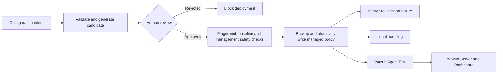
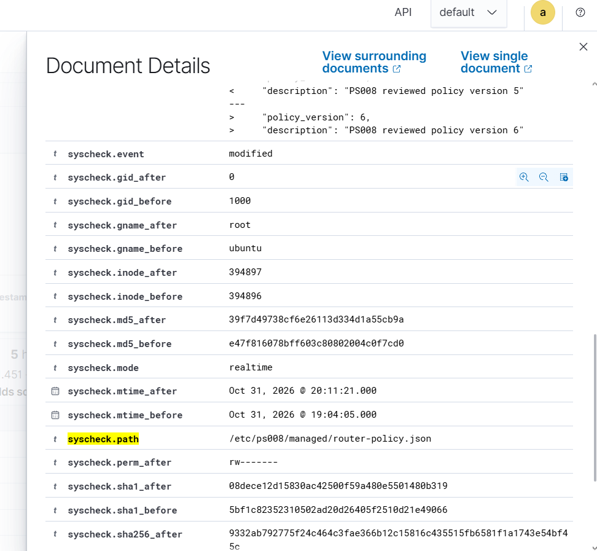

<div align="center">

# PS008 · Reviewed Network Configuration Management

**AIORI Hackathon 3 · Team Ultimateblueteam**

*A Python-based review-before-deploy prototype with configuration validation, protected management settings, rollback, audit logging, and Wazuh file-integrity monitoring.*

[**Evaluator Walkthrough**](docs/evaluator-guide.md) · [**Architecture**](docs/architecture.md) · [**Tests**](evidence/test-results.txt) · [**Wazuh Evidence**](lab/README.md#evidence) · [**Team Video**](https://youtube.com/shorts/BY337KfnYno?feature=share)

</div>

---
## Demonstration Video

[](https://youtu.be/xSbNdJC6a9U)

**[▶ Watch Our Full Project Demonstration on YouTube](https://youtu.be/xSbNdJC6a9U)**

---
## At a glance

| | |
|---|---|
| **Problem statement** | PS008 — Network Management Agent for Reviewed Configuration Changes |
| **Goal** | Prevent unreviewed or unsafe configuration changes from being deployed |
| **Core workflow** | Intent → Validate → Candidate → Human review → Safety checks → Deploy → Audit → Monitor |
| **Deployment target** | Versioned JSON policy on the Ubuntu Router VM |
| **Monitoring** | Wazuh File Integrity Monitoring (FIM) |
| **Validation** | 26 automated tests passed in the recorded development run |

> **Implementation scope:** The prototype simulates router interface and route changes in memory. Its separate real deployment path writes an approved **managed JSON policy file**, not live Linux interfaces, routing tables, or physical network devices.

## System architecture



[Explore the full architecture and module relationships](docs/architecture.md).

### Lab topology

| Component | Host-only IP | Responsibility |
|---|---|---|
| **Wazuh Server VM** | **`192.168.56.3`** | Wazuh manager, indexer, dashboard |
| **Ubuntu Router / Wazuh Agent VM** | **`192.168.56.5`** | Python workflow, managed policy, Wazuh agent |

The protected management interface is **`enp0s8`**, with policy address **`192.168.56.5/24`**. The VMs use separate NAT connectivity. The managed policy is stored at `/etc/ps008/managed/router-policy.json`.

## Verified end-to-end demonstration

| Stage | Observed outcome |
|---|---|
| **Reject** | A rejected candidate was blocked; policy version 5 remained unchanged |
| **Approve** | A reviewed candidate deployed managed policy **v5 → v6** |
| **Protect** | `enp0s8` and `192.168.56.5/24` were preserved |
| **Recover** | A timestamped backup of version 5 was created |
| **Audit** | `REAL_POLICY_DEPLOYED` recorded version 6 deployment |
| **Monitor** | Wazuh rule **550**, level **7**, reported a real-time modification of the managed policy file |

**Evidence note:** The final version 6 alert was verified in the live demonstration. The screenshots below document the earlier Wazuh FIM and compliance monitoring lab; they should not be mistaken for screenshots of that final v6 event. See the [evaluator walkthrough](docs/evaluator-guide.md) for the evidence-to-requirement mapping.

## Wazuh evidence gallery
### Final demonstration — Approved policy deployment detected by Wazuh



**Verified result:** Wazuh detected a real-time modification to `/etc/ps008/managed/router-policy.json` after the reviewed deployment updated the managed policy from version 5 to version 6. The event records `syscheck.event = modified` and changed file-integrity checksums.

---

### Agent connectivity


### File integrity and rule alerts


### File modification details


<details>
<summary><strong>Additional monitoring evidence — GDPR and CIS/SCA</strong></summary>

**GDPR-related view**


**CIS Ubuntu security configuration assessment**


</details>

[Open the full screenshot gallery and monitoring setup](lab/README.md#evidence).

## What the code implements

| Capability | Implementation |
|---|---|
| Validate interface IP and static-route intents | [`src/intents.py`](src/intents.py), [`src/validator.py`](src/validator.py), [`src/route_validator.py`](src/route_validator.py) |
| Generate candidate configurations | [`src/candidate_generator.py`](src/candidate_generator.py) |
| Detect simplified topology cycles | [`src/topology_validator.py`](src/topology_validator.py) |
| Review and fingerprint candidates | [`src/approval.py`](src/approval.py) |
| Simulate deployment and rollback | [`src/deployment.py`](src/deployment.py) |
| Apply versioned managed JSON policies with backup and verification | [`src/real_deployment.py`](src/real_deployment.py) |
| Record local audit events | [`src/audit_log.py`](src/audit_log.py) |
| Coordinate demonstrations | [`src/main.py`](src/main.py) |

The SHA-256 fingerprint checks candidate consistency; it is **not** a digital signature. The demonstration reviewer identity is supplied rather than independently authenticated. Local JSON audit records are not tamper-proof, and deployment does not yet have cross-process locking.

## Run the project

**Prerequisite:** Python 3.10 or newer.

```bash
git clone https://github.com/aiori-hackathon/A3-PS008-TC324.git
cd A3-PS008-TC324
python -m unittest discover -s src -p 'test_*.py' -v
python src/main.py
```

The default demo exercises the **in-memory** router workflow, including successful deployment and simulated failure/rollback. The recorded test run passed **26 tests**; rerun the command above to verify the current checkout.

### Managed-policy demonstration (Ubuntu Router VM only)

Requires the configured lab environment and write access to `/etc/ps008/managed/`. Run from the `src` directory using the project's virtual environment:

```bash
cd src
sudo ../.venv/bin/python -c "from main import run_managed_policy_workflow; run_managed_policy_workflow(decision='reject', reviewer='demo-reviewer')"
sudo ../.venv/bin/python -c "from main import run_managed_policy_workflow; run_managed_policy_workflow(decision='approve', reviewer='demo-reviewer')"
sudo python3 -m json.tool /etc/ps008/managed/router-policy.json
```

**Note:** Approval increments the current managed policy version. Re-running it may produce a later version than the documented v5 → v6 demonstration. It changes a managed JSON file, not live network routing.

## Evaluation links

- **[Evaluator walkthrough](docs/evaluator-guide.md)** — what works, evidence, limitations, and a concise assessment path.
- **[System architecture](docs/architecture.md)** — reviewed-change and Wazuh monitoring flows.
- **[Recorded test results](evidence/test-results.txt)** — development-run output.
- **[Managed deployment tests](src/test_real_deployment.py)** — safety and rollback scenarios.
- **[Wazuh lab documentation](lab/README.md)** — FIM setup and screenshots.
- **[Team introduction video](https://youtube.com/shorts/BY337KfnYno?feature=share)**.

---

<div align="center">

**AIORI Hackathon 3 · PS008 · Ultimateblueteam**

*Review first. Deploy safely. Monitor independently.*

</div>
