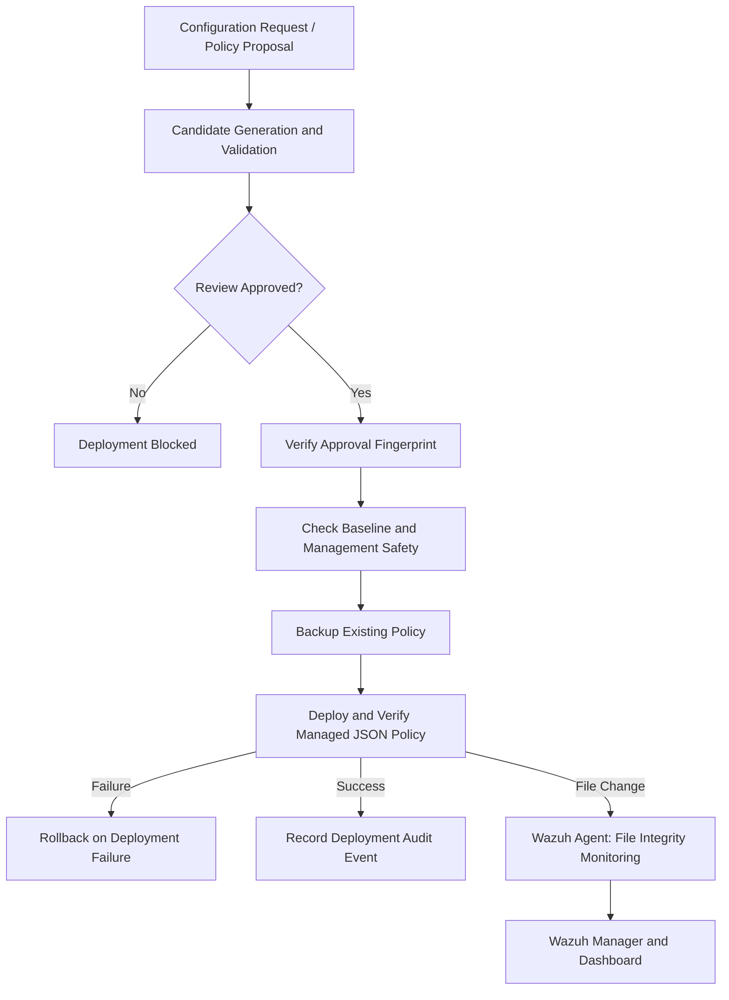

# PS008 — System Architecture

## Lab Components

- **Ubuntu Router VM:** Python management agent, managed JSON policy, local audit log, and Wazuh agent.
- **Wazuh Server VM:** Wazuh manager, indexer, and dashboard.
- **Network:** VirtualBox host-only management network and separate NAT connectivity.

## Reviewed Configuration Workflow

## Important Distinction

The project has two deployment paths:

1. **Simulated router workflow:** Validates interface and route changes and deploys them to an in-memory router model.
2. **Managed policy workflow:** Applies reviewed changes to `/etc/ps008/managed/router-policy.json`, with backup, verification, rollback handling, audit logging, and Wazuh FIM monitoring.

The managed policy workflow does not change live network interfaces or routing tables.
