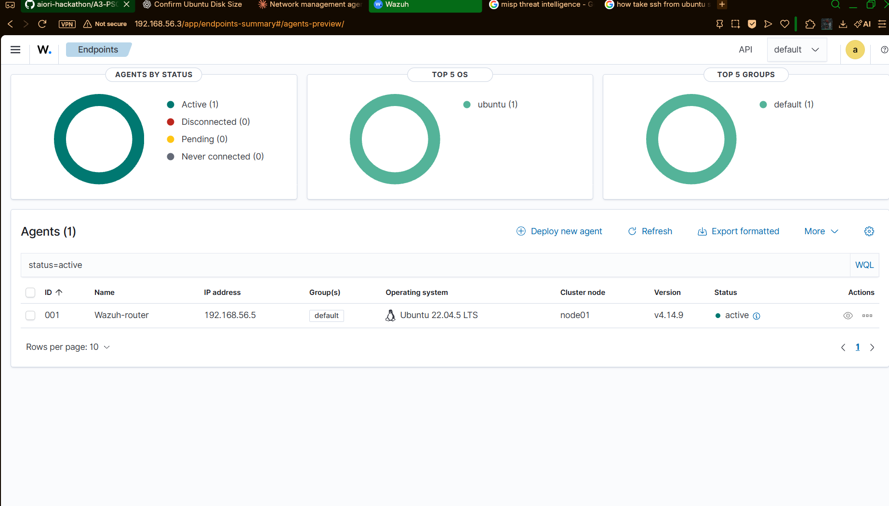
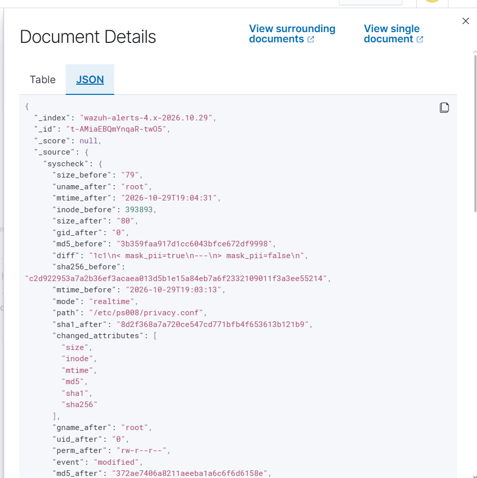
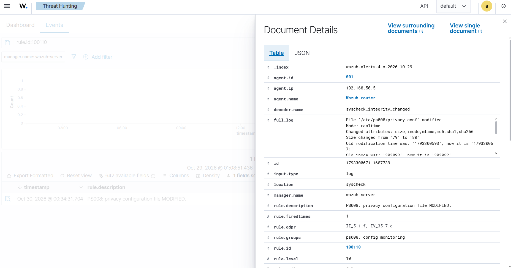
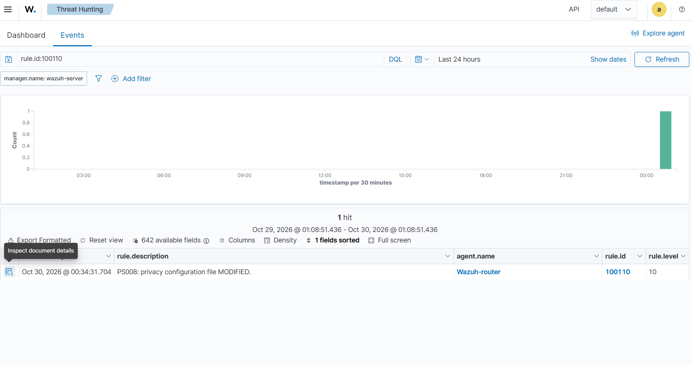
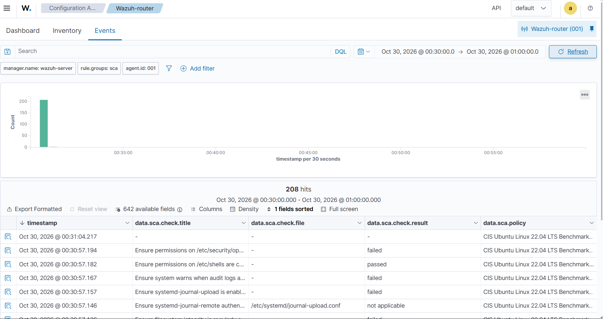

# PS008 — Evaluator Walkthrough

**AIORI Hackathon 3 | Team Ultimateblueteam | Problem Statement PS008**

[← Main README](../README.md) · [Architecture](architecture.md) · [Wazuh screenshots](../lab/README.md#evidence) · [Test results](../evidence/test-results.txt)

## 60-second project summary

PS008 demonstrates a **review-before-deploy** network-configuration workflow. A Python agent validates configuration intents and generates candidates. A reviewer approves or rejects a candidate; integrity and stale-baseline checks prevent certain unsafe deployments. The prototype includes a simulated three-router model and a **separate real file-deployment path** that writes approved managed JSON policies to the Router VM. Wazuh File Integrity Monitoring independently detects policy-file changes.

**What it does not do:** It does not change live Linux interface settings, routing tables, or physical routers. Demo reviewer names are not authenticated identities, and SHA-256 candidate fingerprints are not digital signatures.

## Lab topology

| Component | Host-only management IP | Purpose |
|---|---|---|
| Wazuh Server VM | **`192.168.56.3`** | Wazuh manager, indexer, dashboard |
| Ubuntu Router / Wazuh Agent VM | **`192.168.56.5`** | Python agent, managed policy, Wazuh agent |

- Protected management interface: `enp0s8`
- Managed file: `/etc/ps008/managed/router-policy.json`
- Management IP in policy: `192.168.56.5/24`
- NAT connectivity is separate from the host-only management network.

## What evaluators can verify

| Requirement | Implementation | Evidence |
|---|---|---|
| Validate intent and generate candidate | `src/intents.py`, `src/candidate_generator.py` | [Unit tests](../evidence/test-results.txt) |
| Human review decision | `src/approval.py` | Rejected proposal blocked in demo |
| Prevent post-approval candidate drift | SHA-256 consistency check in `src/approval.py` | `src/test_workflow_safety.py` |
| Block stale or management-network changes | `src/real_deployment.py` | `src/test_real_deployment.py` |
| Apply and verify approved managed policy | `src/real_deployment.py` | Observed v5 → v6 deployment |
| Preserve prior configuration | Timestamped `.json.bak` backup | Observed v5 backup alongside v6 policy |
| Rollback on verification failure | Deployment code and simulated-failure test | `src/test_real_deployment.py` |
| Record deployment | `src/audit_log.py` | `REAL_POLICY_DEPLOYED` for version 6 |
| Independent change detection | Wazuh agent and manager | Rule `550`, `syscheck.event=modified`, `syscheck.mode=realtime` |

**Observed final demonstration (31 October 2026):** A rejected candidate left version 5 unchanged. An approved candidate deployed version 6, retained `enp0s8` and `192.168.56.5/24`, and created a version 5 backup. The audit log recorded `REAL_POLICY_DEPLOYED`. The Wazuh dashboard displayed rule **550**, level **7**, for `/etc/ps008/managed/router-policy.json`, with a real-time modification event and changed checksums.

> The screenshots already committed under `lab/screenshots/` are from the earlier privacy-file FIM/compliance lab (including custom rules 100110–100112), **not** the final version 6 deployment. The version 6 Wazuh screenshot was verified during the demo but is not claimed as a committed image here.

## Screenshot gallery — existing committed evidence

### 1. Wazuh agent active


### 2. Wazuh monitoring alerts


### 3. File integrity change details


### 4. GDPR-tagged event view


### 5. Security configuration assessment


## How to reproduce safely

Run unit tests from the project root:

```bash
python -m unittest discover -s src -p 'test_*.py' -v
```

Run the **in-memory** router demonstration:

```bash
python src/main.py
```

On the configured Router VM, from the `src` directory, run a **rejection-only** managed-policy demo (does not increment the managed policy version):

```bash
sudo ../.venv/bin/python -c "from main import run_managed_policy_workflow; run_managed_policy_workflow(decision='reject', reviewer='demo-reviewer')"
```

To perform a new **approved managed-policy deployment**, substitute `decision='approve'` in the command above. **This writes to `/etc/ps008/managed/router-policy.json` and increments its version**; use only in the intended lab after checking the current policy and backup.

## Honest limitations and next steps

- The real deployment target is a managed policy JSON file, not live network configuration.
- Approval identities are demonstration inputs rather than independently authenticated accounts.
- Fingerprints detect unintended candidate drift but do not provide tamper-proof authorization.
- Cross-process deployment locking and fully transactional crash recovery are not implemented.
- Local JSON audit logs are not immutable or tamper-proof.
- Future work: authenticated review, secure device adapters, stronger concurrency and audit protections, and richer review UI.

## Repository map

- [Main workflow](../src/main.py)
- [Approval gate](../src/approval.py)
- [Managed deployment](../src/real_deployment.py)
- [Audit logging](../src/audit_log.py)
- [Wazuh integration](../src/wazuh_integration.py)
- [Managed deployment tests](../src/test_real_deployment.py)
- [Architecture diagram](architecture.md)
- [Wazuh lab details](../lab/README.md)
